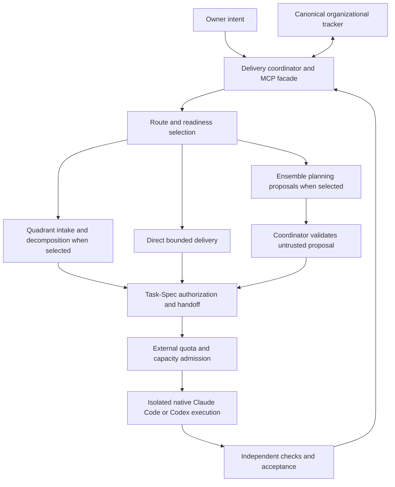

# Governed composition proposal

Status: experimental design, not implemented. Date: 2026-11-05.
Scope: a single managed delivery system that can use existing harnesses, Task-Spec,
Quadrant, and an optional MetaGPT-derived planning engine.

## Authority model

The owner supplies business intent and reserves business/irreversible decisions. One
external delivery coordinator owns reversible technical routing, execution admission,
independent acceptance, and integration under the applicable policy. A role named CEO,
architect, reviewer, or team leader does not gain those authorities by its title.

The MCP facade exposes coordinator operations. Ensemble is an optional subordinate
component behind it. Neither the language model nor the MCP transport itself is a policy
enforcement boundary. Untrusted clients cannot obtain privileged operations merely by
calling a tool with a suggestive name.

## Separate three routing decisions

| Decision | Values or examples | Evidence needed |
| --- | --- | --- |
| Assurance route | HARNESS, TASK_SPEC, QUADRANT | Scope, dependencies, persistence, risk, applicable policy and real tool readiness. |
| Planning engine | Direct coordinator reasoning, Ensemble proposal | Need for role decomposition and measured benefit. |
| Execution backend | Native authenticated Claude Code or Codex | Allowlisted provider/model, effective identity, capabilities, auth mode and quota. |

HARNESS still retains applicable mandatory controls. TASK_SPEC is not a competing model
runtime. Quadrant can compose Task-Spec and a harness, and can request Ensemble proposals.
The user's explicit engine choice remains a constraint; unavailable readiness must be
reported rather than silently substituting another engine or paid API.

## State ownership

| State | Authority | Other representations |
| --- | --- | --- |
| Business goal, priority and organizational owner | Existing canonical tracker | Ensemble receives a minimized snapshot with stable IDs. |
| Authorized scope and acceptance contract | Task-Spec artifacts and validating authority | Tracker links to the contract; model output cannot edit its seal. |
| Execution attempt and admission reservation | Trusted coordinator/admission ledger | Tracker and MCP show projections of the attempt. |
| Code and deliverable bytes | Git commit/tree and artifact digests | Messages link to immutable artifacts. |
| Acceptance | Independent acceptance record bound to the exact candidate | Tracker done-state is reconciled from that record. |
| Credentials, isolation and global resource policy | Trusted infrastructure outside workers | Workers receive only task-scoped capabilities. |
| Team memory and role plans | Non-authoritative Ensemble working state | Rebuildable from authorized inputs and retained proposals. |

The existing tracker, if retained, owns organizational work IDs. Do not mirror an entire
second backlog into MetaGPT and make both independently writable. This research fork is
not a new tracker and does not choose a replacement for the existing one.

## Proposed delivery lifecycle

1. Resolve the existing project/work item or create it once through the canonical intake.
2. Recommend an assurance route, optional planning engine, and execution backend separately.
3. Before any model call, trusted admission checks the applicable quota and capacity,
   including planning/coordinator inference. A bounded planning invocation is distinct from
   an authorized implementation attempt. If selected, Ensemble returns a structured proposal referencing existing IDs. The proposal
   is untrusted and cannot reserve resources, create callable workers, or accept its own work.
4. The coordinator validates scope, dependencies, readiness and any required Task-Spec seal.
5. Trusted admission reserves global capacity and provider quota for a unique attempt.
6. The native harness executes within an assigned worktree and capability boundary.
7. The result becomes `submitted`; independent verification binds evidence to its exact SHA.
8. Only acceptance allows integration and the canonical accepted/done projection. A failure
   releases or retains resources under an explicit lifecycle; it does not release dependents.

Proposed state vocabulary:
`proposed -> authorized -> admitted -> running -> submitted -> accepted -> integrated`.
Failure/cancellation states are explicit. Existing tracker statuses may project these states;
they do not need to adopt this exact vocabulary. No runtime state machine is added here.

## Admission and retry invariants

- Every model invocation and implementation launch crosses the same trusted admission
  policy, including planner/coordinator inference. Every launch origin is covered: user/MCP request, timer,
  assignment, mention, retry, resume, review reentry, internal trigger and executor child work.
  Disabling one trigger class does not prove coverage of the others.
- Bind each attempt to canonical work ID, contract digest, repository/base SHA, provider/model,
  capabilities and a coordinator-issued attempt ID. The model cannot mint authorization.
- An idempotency key prevents duplicate requests from creating a second attempt. A live
  attempt's identity and reservation cannot be reused to authorize new sibling execution.
- Do not promise exactly-once execution across a crash. Use durable attempt records, fenced
  leases and reconciliation of the real executor before retry. An ambiguous dispatch remains
  `unknown` until reconciled; it is never blindly rerun.
- Reserve before launch; retain capacity until the real process tree is terminated and
  reconciled. Missing callbacks and expired leases are not proof that a worker is gone.
- Quota snapshots include observation time, reset and window identity. Unknown, stale or
  absent required data fails closed. Estimated API price is not subscription usage.
- Containment and cancellation have a trusted path independent of the facade and planner.
  Loss of the control channel must not convert to permission for autonomous new execution.

## Capability boundaries

The first planner experiment exposes no terminal, browser, editor, PR/deploy tool, arbitrary
HTTP tool, tracker write credential, or direct child-worker dispatch. Disabling these
capabilities is an implementation requirement, not an achieved property of upstream code.
Use synthetic/minimized inputs; never load private company context into a broadcast team.

Later executor integration must declare process, filesystem, network, database and auth
boundaries separately. A Git worktree separates files and index ownership; it is not a
security sandbox. Subscription credentials required by an executor remain sensitive even
when billing keys are absent. Choose and verify the concrete isolation mechanism in a
separate implementation contract; no VM/container topology is certified by this document.

No generated worker receives production, external messaging, payment, deployment or
company-governance credentials. Independent acceptance runs outside the writer's writable
surface and does not execute arbitrary imported artifacts as part of rendering a report.

## Proposed MCP facade

These are interface sketches only. Tool names use `ensemble_` for discoverability even
when a request selects another engine. A future umbrella interface may choose a neutral
namespace without changing the authority model.

| Tool | Proposed behavior | Boundary |
| --- | --- | --- |
| `ensemble_plan` | Return a proposal for an existing work item and selected route/engine. | Planning inference requires admission; no implementation execution or queue mutation. |
| `ensemble_start` | Submit an authorized handoff and idempotency key; return an attempt ID. | Trusted coordinator validates and admits; callers cannot inject shell commands or arbitrary paths. |
| `ensemble_status` | Return authoritative attempt state, evidence gaps and observation time. | Read access scoped to the caller/project. |
| `ensemble_artifacts` | Return manifest and references/digests for allowed artifacts. | No credential/log dumping or automatic execution. |
| `ensemble_cancel` | Request cancellation and expose reconciliation state. | Acknowledged request is distinct from confirmed termination. |

Default to job IDs and polling until actual client support for long-running MCP tasks has
been verified. Capture and isolate upstream stdout so it cannot corrupt a stdio MCP stream.
The conversational agent translates user intent into these operations; saying a tool name
in conversation does not implement the backend or establish its readiness.

## Adoption and rollback

Start in shadow mode: recommendations are compared with the current path and cannot
dispatch. Next, prove one native executor adapter, then one admitted development task.
Keep the same acceptance criteria and canonical work IDs in each baseline comparison.

Disable the Ensemble engine/facade entry and continue with the existing coordinator and
harness if the experiment fails. Preserve proposals/evidence and reconcile all running
attempts before shutdown. No migration of company state or production data is part of
this fork. Any such migration needs its own scope, verification and rollback.
