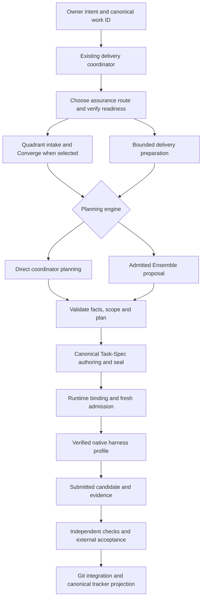

# Ensemble POC assessment and delivery integration

Date: 2026-11-06. Scope: the completed local 2048 pilot and a proposed integration
with the existing delivery system. Recommendations are not an installed router,
a Quadrant adoption record, or authorization to dispatch additional work.

## 1. Decision and owner acceptance

The POC passed its functional objective. A real local MCP request led to native
Claude planning, native Codex generation, independent checks and review, external
Task-Spec acceptance and Git integration. The owner then personally played the game
and confirmed that it was fully playable, in the conversation on 2026-11-06.

That confirmation is **reported functional acceptance**. It complements the measured
checks; it is not a claim of 100% automated coverage or a recorded user-session trace.

Ensemble fits as an optional planning engine used by the delivery coordinator.
Its strongest proposed position is requirement elaboration and solution decomposition,
before final implementation Task-Specs are sealed. It can also elaborate a solution
inside an existing contract, as demonstrated here.

General adoption remains experimental. The POC proves a working composition for a
fixed template. It does not prove better planning than direct coordinator reasoning,
support for arbitrary repositories, or independent software-company management.

## 2. What actually ran

The implementation extracts selected declarative MetaGPT planning nodes from pinned
upstream source using Python AST. It does not import executable roles, run the stock
company, hire Engineer2 or invoke the upstream API providers. Three planning stages
produce summaries, decisions and risks: requirements, design and tasks.

The successful sequence was:

1. The coordinator registered an existing signed Task-Spec with four exact game paths.
2. An official MCP SDK client called `ensemble_plan` for that canonical work ID.
3. Three admitted native Claude calls produced advisory planning data.
4. The client called `ensemble_start` with the plan and an idempotency key.
5. The controller checked bindings and the browser runtime, then admitted native Codex.
6. Codex returned JSON files without tools or a checkout; the controller materialized them.
7. Offline logic/browser checks ran, followed by an independent native Claude review.
8. The candidate became `submitted`, awaiting external acceptance.
9. The coordinator checked provenance, integrated the exact bytes, ran canonical
   acceptance and merged the PR. The ledger then projected the accepted outcome.
10. The owner tested the playable result.

The implementation contract existed **before planning**. The POC did not demonstrate
receiving an open-ended idea and automatically creating its implementation contracts.
Its stage named `tasks` produced planning text, not signed Task-Specs.

### Results and evidence

| Item | Result | Evidence basis |
| --- | --- | --- |
| Planning | Three calls, `claude-sonnet-5-5`, Claude Code 2.1.318 | Effective native identity recorded |
| Generation | `gpt-6-sol`, medium effort, Codex CLI 0.165.0 | Effective native identity recorded |
| Final candidate | Passed without a code correction on the corrected runtime | Retained files and manifest |
| Logic | 149 cases passed | Deterministic offline evaluator |
| Browser | Keyboard, direction buttons, restart, 360px viewport; zero external requests | Isolated browser checks |
| POC controls | 35 tests passed | Controller, PostgreSQL and Linux boundary suite |
| Phase 0 | All 29 tests passed | Existing regression suite |
| Independent review | Controller revalidation, runtime correction and game review returned PASS | Native Claude reviews, separate from execution checks |
| Contracts | Five canonical Tier 1 acceptance records | Versioned Task-Spec receipts |
| Restart/replay | Same accepted attempt, no additional native calls | New official SDK client connection |
| Owner gameplay | Fully playable, personally tested | Owner report |

Planning took **66.52 seconds**; generation, checks and review took **93.53 seconds**.
The **160.05-second** sum excludes cold implementation, prior failures, controller
reviews, waiting, integration and final acceptance. It is not total project delivery
time or a productivity comparison. Provider token totals were not retained by the
initial adapters. Subscription inference still consumes tokens and quota; API list
prices are not subscription charges.

### Inspectable artifacts

- [Technical results](functional-poc.md): controls, failures and evidence limits.
- [Generated game](../../../examples/ensemble-2048/): four files preserved byte-for-byte.
- [Planning adapter](../../../ensemble_poc/planner.py): upstream pins and advisory schema.
- [Controller](../../../ensemble_poc/service.py): dispatch and submission/acceptance separation.
- [Acceptance records](../../../.taskspec/acceptance/): five `T-20261106-*` receipts.
- [Merged PR #3](https://github.com/whoisthiagosantana/syncronyia-ensemble/pull/3).

Implementation merge: `76b9e9c3a72d0a8cdc154967910f62ecb4c8ea47`.
Game integration: `229ff65c7bfbf81c3f475c018e901efe0ad4cfc2`.
Raw provider records, account observations and local inventories remain private.

## 3. Failures, corrections and remaining limits

The first native attempt generated valid logic twice: both candidates passed 149
cases. Chromium failed before opening a page. The loop spent its correction round
on that infrastructure failure, and the attempt remains `blocked / CORRECTION_LIMIT`.
The successful result does not erase it.

Increasing memory from 768 MB to 1 GB did not fix the 64-task browser profile. The
same candidate passed at 256 tasks and 768 MB. A trusted, pinned browser positive
control now runs before generation. A fresh explicit request completed the full path.
Per-candidate verification reports are retained.

Review also found a verifier-design defect: untrusted game code could share the
assertion/reporting process. Execution now runs separately. A forged-success fixture
and a vulnerable direct-import mutant demonstrate the difference. Other fixes covered
output flooding, launch/replay races, source/harness pinning and the SDK's filtered
user-bus environment. Independent revalidation and the focused runtime review passed.

What remains outside the demonstrated scope:

- Multiple users, concurrent implementation attempts and arbitrary project templates.
- Open-ended idea-to-contract generation and existing-repository changes.
- Tool-capable native coding workers; these adapters produce data only.
- Provider-only egress: trusted native CLIs use host networking.
- Paperclip synchronization, Quadrant-driven delivery and production deployment.
- Planning ROI, comparative cost and a generalized company-management control plane.

Generated code does run separately and offline, without credentials, signing keys
or a host checkout. The Phase 0 gate validates a coordinator-built envelope, not
planning quality. HMAC proves contract integrity, not isolation or semantic quality.
External acceptance and integration remain coordinator operations, not role messages.

## 4. Position in the development flow

Separate composable decisions rather than treating every component as an interchangeable executor:

| Layer | Responsibility | Choices or owner |
| --- | --- | --- |
| Organizational work | Goal, priority, owner and canonical IDs | Existing tracker; Paperclip if selected and integrated |
| Assurance route | Delivery process and required evidence | HARNESS, TASK_SPEC or QUADRANT |
| Planning engine | Requirements, alternatives, risks and decomposition | Direct coordinator reasoning or Ensemble |
| Execution backend | One admitted implementation task | Native Claude Code or Codex under a verified profile |
| Acceptance/integration | Independent checks and reversible technical decisions | External coordinator and canonical gates |

HARNESS retains applicable house controls. Task-Spec is the contract. Quadrant
composes intake, Converge and delivery controls. An Ensemble proposal can therefore
be used inside TASK_SPEC or QUADRANT delivery, followed by a native harness.

### Proposed Converge hooks

| Stage | Ensemble contribution | Boundary |
| --- | --- | --- |
| Before/at Pass 1, requirements | Draft goals, scenarios, ambiguities and requirement candidates | Owner intent and the requirement gate remain authoritative |
| Pass 2, grounding | Organize supplied repository evidence and expose missing facts | Coordinator verifies facts; this pass remains terrain grounding, not solution design |
| Pass 3, decomposition | Propose alternatives, seams, dependencies and build order | Primary integration point; keep output at plan altitude |
| Pass 4, consensus | Supply a proposal to an independent adversary | The generating team cannot self-approve; active house/client authority applies |
| Pass 5, Task-Spec | Supply validated planning references as authoring evidence | Canonical tools create/seal atomic contracts |
| Pass 7/8, bind/execute | Optional clarification after explicit re-admission | Runtime binding and execution remain with existing controls/harnesses |

A Pass 3 adapter must not promote the POC's `tasks` text into atomic signed tasks.
Pass 5 owns that transformation. This proposal adds no repeated owner approval for
reversible technical work; business and irreversible decisions keep their real boundaries.

## 5. Selection by agents

Register Ensemble in a **capability catalog consumed by the existing coordinator**.
Reuse its authoritative work queue and runtime ownership. A second dispatcher,
organizational backlog or scheduler is unnecessary.

Each capability entry should name supported stages, input/output contracts, allowed
profiles, version/source, privacy/tool boundaries, admission, acceptance evidence and
readiness. Distinguish verified-for-a-profile, experimental and unavailable. An
installed binary or discoverable skill is not proof of project adoption.

Initially register `ensemble.2048` for the measured profile. A future general planning
adapter remains experimental until its own checks pass. Keep other routes' actual
readiness records instead of inferring them from this POC.

| Demand | Recommended composition | Reason |
| --- | --- | --- |
| Small clear correction with an established check | HARNESS, direct planning, applicable mandatory contracts | Avoid an unmeasured planning stage |
| Bounded feature needing explicit acceptance | TASK_SPEC, direct planning by default | Scope, evals and handoff are the main need |
| Bounded feature needing product/design alternatives | TASK_SPEC plus experimental Ensemble planning, then harness | Test planning benefit while keeping acceptance |
| Product, structural transition or dependent fronts | QUADRANT; selective Ensemble requirements/decomposition | Intake and cross-front governance remain necessary |
| Explicit Ensemble request | Check the exact supported profile and readiness | Honor the choice; report a gap instead of silently substituting |
| Already signed task | Its authorized harness | A planning change needs a proposal and deliberate contract revision |

These are advisory defaults, not calibrated cost/quality scores. Keep Ensemble
opt-in while measuring its benefit. Choose provider/model separately under current policy.

A future decision record could summarize the composition:

```json
{
  "assurance_route": "TASK_SPEC",
  "planning_engine": "ensemble",
  "execution_backend": "codex",
  "planning_profile": "bounded_feature",
  "reason": "Product and design alternatives need comparison before tasking"
}
```

This is a proposed record, **not today's MCP request schema**. The actual decision
must bind canonical IDs, source/input snapshots, contract revision, effective
provider/model and the capability evidence used.

## 6. Proposed common flow



For pre-contract use, authorize a bounded planning brief before inference: purpose,
supplied evidence, permitted outputs, privacy, call/resource budget, timeout and
cancellation. It authorizes planning only. Validate the proposal, then convert it
to the existing tech-spec, swimlane or TaskPlan format at the appropriate stage.
Implementation Task-Specs are sealed afterward.

Link proposal digests to accepted plan/contract revisions. Return unresolved business
requirements to their owner. The coordinator can settle reversible technical choices
within delegated authority. Model-produced approval fields never grant authority.

MCP transports planning, start, observation, artifacts and cancellation. A future
neutral delivery facade can route to Ensemble as an adapter. That proposal is not
a new runtime. Reuse the adopted coordinator/runtime ledger; the POC's PostgreSQL
ledger must not become a competing project queue.

Reconcile real processes before retrying ambiguous dispatch. Keep submission separate
from acceptance, and project tracker completion from canonical acceptance evidence.

## 7. Recommended integration increments

1. **Catalog and decision contract.** Add a versioned capability entry, supported
   profile, readiness evidence and routing reason to the existing coordinator.
2. **Planning-only adapter.** Accept a bounded brief and repository evidence; emit
   canonical requirement/plan authoring evidence. Independently reject invented facts,
   lost requirements, scope expansion and self-authorization. Execution stays in the
   existing harness instead of creating another generic coding loop here.
3. **Representative comparison.** Choose a bounded existing-repository feature and
   compare direct versus Ensemble planning with the same frozen base, requirements,
   independent holdouts and acceptance. Record corrections, first/final acceptance,
   defects, setup/recurring time, observed usage and operational interventions.

Select the project and portfolio priority with the owner. Expand automatic selection
only after evidence of benefit. Another successful toy does not establish broad
superiority. Paperclip integration, more templates and tool-capable profiles each
need their own scope and verification.

The operating model is one coordinator, an optional proposal engine, canonical
contracts, verified native execution and independent acceptance. Owner gameplay
closes the POC's usability question; it does not close planning ROI, general repository
support, company management or production readiness.
